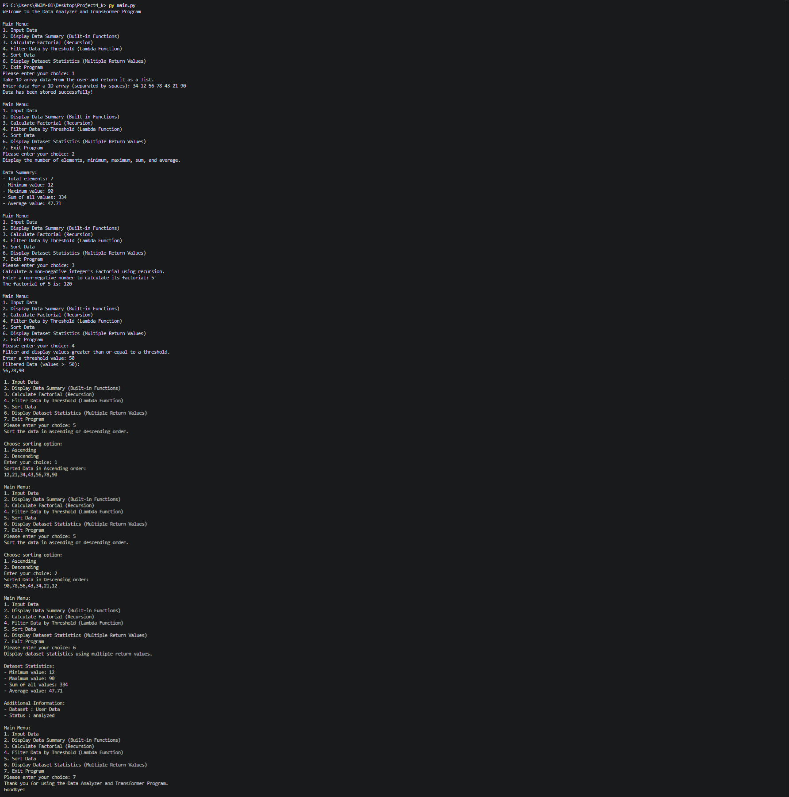

# 📊 Functional Treat – Data Analyzer and Transformer Program

---

## 📖 Project Description

**Functional Treat** is a menu-driven, command-line Python program that analyzes and transforms a 1D list of whole numbers. It is built around **functional programming** ideas: built-in functions, recursion, lambda functions, `filter()`, `sorted()`, and functions that return multiple values.

The user enters a dataset once and can then summarize it, filter it, sort it, and view its statistics, as well as calculate the factorial of any number.

---

## ✨ Features

- 📥 **Input Data** – store a 1D array of integers entered by the user
- 🧮 **Data Summary** – total elements, minimum, maximum, sum, and average using built-in functions
- 🔁 **Factorial Calculator** – computes the factorial of a non-negative number using **recursion**
- 🔍 **Filter by Threshold** – keeps values greater than or equal to a threshold using a **lambda function** with `filter()`
- ↕️ **Sort Data** – sorts the data in ascending or descending order
- 📈 **Dataset Statistics** – uses **multiple return values**, `*args`, and `**kwargs` to display statistics with additional information
- 📝 **Docstrings** – each function describes itself and is shown when its option is selected
- 🛡️ **Input Validation** – handles non-numeric input, negative factorials, invalid menu choices, and empty data gracefully
- 🔄 **Interactive menu loop** that runs until the user chooses to exit

---

## 🛠️ Technologies Used

| Technology | Purpose |
|------------|---------|
| 🐍 **Python 3** | Core programming language |
| 🧩 **Functional Programming** | Recursion, lambda, `filter()`, `sorted()`, `*args` / `**kwargs` |
| 💻 **Command Line (CLI)** | User interaction via `input()` and `print()` |
| 🆚 **Visual Studio Code** | Code editor used for development |
| 🌿 **Git** | Version control |
| 🐙 **GitHub** | Hosting the repository and sharing the project |

---

## 🚀 How to Run

1. **Make sure Python 3 is installed**
   ```bash
   python --version
   ```

2. **Clone or download the project**
   ```bash
   git clone <your-repository-url>
   cd <project-folder>
   ```

3. **Run the program**
   ```bash
   python main.py
   ```


4. **Follow the on-screen menu**
   ```
   Main Menu:
   1. Input Data
   2. Display Data Summary (Built-in Functions)
   3. Calculate Factorial (Recursion)
   4. Filter Data by Threshold (Lambda Function)
   5. Sort Data
   6. Display Dataset Statistics (Multiple Return Values)
   7. Exit Program
   ```

---

## 📂 Project Structure

```
 ├── 📄 main.py   
 ├── 📄 output.png
 └── 📄 README.md    
```

### 🧱 Functions Overview

| Function | Description |
|----------|-------------|
| `input_data()` | Reads space-separated integers and stores them |
| `display_summary(data)` | Shows count, min, max, sum, and average |
| `factorial(n)` | Recursive factorial calculation |
| `calculate_factorial()` | Prompts for a number and prints its factorial |
| `filter_data(data)` | Filters values using a lambda and a threshold |
| `sort_data(data)` | Sorts data in ascending or descending order |
| `calculate_statistics(data)` | Returns min, max, sum, and average together |
| `display_statistics(*args, **kwargs)` | Displays statistics and additional information |
| `main()` | Runs the main menu loop |

---

## 🖥️ Output


---

## 👩‍💻 Author

**Kajal**

---
